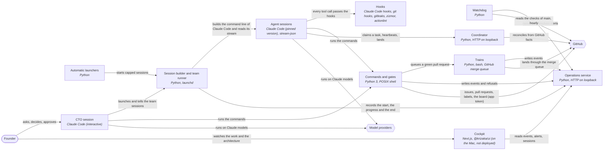
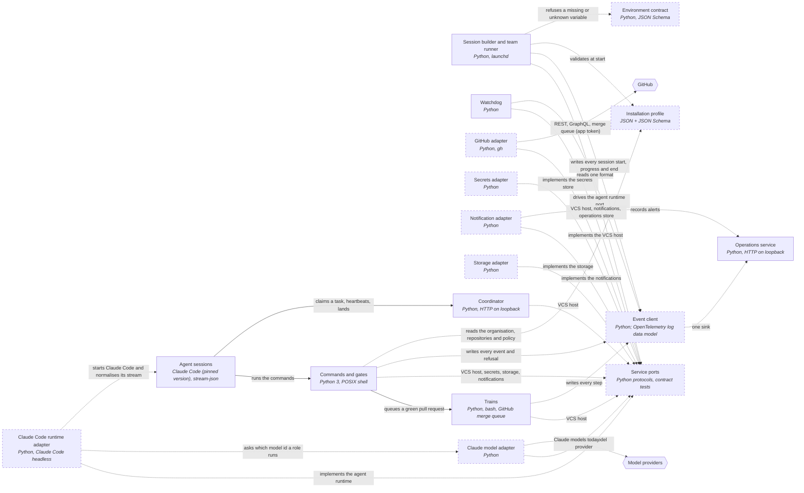

# Krizaka Agents

[Français](#français) · [English](#english)

## English

**Krizaka Agents is how we ship with coding agents: what surrounds Claude Code to ship work.** Coding agents that deliver by pull request,
with automatic refusals before the push and a person who decides.

It is our own technology: the one we build our products with (Sovkora, Verikora, Folioviv, Kridoc). It is **in development**
and keeps evolving. **It is not for sale for now**: no offer, no price, no installation service. This page shows the method.

**The code of Krizaka Agents is private and is not published here.** This repository holds only its public documentation.

### How it works

1. **A person decides.** The founder talks to one interactive Claude Code session, the CTO. It files the issue, sizes it and
   launches the work. The agents work the issues that exist; they do not choose what is built.
2. **Every session starts in the same world.** A builder starts each headless Claude Code session the same way: a pinned
   version, isolated settings, the allowed tools only, caps on turns, budget and minutes. A session that drifts from that world
   is stopped as it starts.
3. **A coordinator hands out bounded tasks.** A task has a file scope and a lease; two sessions never write the same files.
4. **Refusals come before the push.** Hooks check every tool call and every commit and push: no secret, no wrong identity, no
   unformatted code, no red fast check. A refusal names its fix; nothing is skipped to get green.
5. **Pull requests catch the train.** Each repository has one ordered landing queue; a train takes each green pull request
   through the merge queue, stops on red and calls for help at the second red.
6. **After the merge, an acceptance check.** A capped session checks each line of the issue's « done when » on the real
   platform, then closes the issue with proofs or sends it back.
7. **Alerts have an owner.** A watchdog reads the runs, the trains and the sessions; every alert lands in one operations store,
   and the cockpit shows what is really running.

### Today

What runs today, on one machine (generated from the public view `agents_public_current` of our architecture model):



### Where it is going

The target (generated from the public view `agents_public_target`; dashed: planned): one event format and one sink for every
session, train, refusal and alert; one installation profile, so it installs on another GitHub organisation by configuration
only; environment variables named by role, never by provider, checked at start; and **ports with adapters** between the
system and what it depends on (VCS host, agent runtime, model provider, secrets, storage, notifications, operations store).
The agent runtime (today Claude Code) and the model (today Claude) are two adapters behind one runtime port: either can change
without touching the coordinator, the trains or the guards.



### Read the chapters

The story of how it was built, chapter by chapter, on the blog:

- [Building almost alone, with agents](https://blog.krizaka.com/story/building-with-agents/)
- [How the CTO agent and I work](https://blog.krizaka.com/story/how-the-founder-and-the-cto-agent-work/)
- [All aboard: how our pull requests catch the train](https://blog.krizaka.com/story/tchou-tchou-how-our-pull-requests-catch-the-train/)
- [The trains, second version: rails, a siding and a repair train](https://blog.krizaka.com/story/the-trains-second-version-rails-sidings-and-a-repair-train/)
- [Working with agents: rules that say no](https://blog.krizaka.com/story/working-with-agents-rules-that-refuse/)
- [The error no longer leaves the editor](https://blog.krizaka.com/story/ci-the-error-never-leaves-the-editor/)
- [Agents under a coordinator: what broke, and how we caught it](https://blog.krizaka.com/story/agents-under-a-coordinator/)
- [Every agent starts in the same world](https://blog.krizaka.com/story/every-agent-starts-in-the-same-world/)
- [Inside the machine room: how our agent teams talk to each other](https://blog.krizaka.com/story/how-our-agent-teams-talk/)
- [The ergonomics of a cockpit: one screen per question](https://blog.krizaka.com/story/one-local-cockpit-to-run-the-whole-company/)
- [The architecture of krizaka-agents, for enterprise architects](https://blog.krizaka.com/story/the-architecture-of-krizaka-agents/)

Our website: **https://www.krizaka.com** · our open-source libraries: https://github.com/krizaka

## Français

**Krizaka Agents est la façon dont nous livrons avec des agents de code : ce qui entoure Claude Code pour livrer.** Des agents de code qui
livrent par pull request, avec des refus automatiques avant le push et une personne qui décide.

C'est notre propre technologie : celle avec laquelle nous construisons nos produits (Sovkora, Verikora, Folioviv, Kridoc). Elle
est **en développement** et évolue encore. **Elle n'est pas à vendre pour l'instant** : ni offre, ni prix, ni service
d'installation. Cette page montre la méthode.

**Le code de Krizaka Agents est privé et n'est pas publié ici.** Ce dépôt ne contient que sa documentation publique.

### Comment ça marche

1. **Une personne décide.** Le fondateur parle à une session Claude Code interactive, le CTO. Elle ouvre le ticket, le
   dimensionne et lance le travail. Les agents traitent les tickets qui existent ; ils ne choisissent pas ce qui se construit.
2. **Chaque session démarre dans le même monde.** Un constructeur démarre chaque session Claude Code sans interface de la même
   façon : une version épinglée, des réglages isolés, les seuls outils permis, des plafonds de tours, de budget et de minutes.
   Une session qui s'écarte de ce monde est arrêtée dès son démarrage.
3. **Un coordinateur distribue des tâches bornées.** Une tâche a un périmètre de fichiers et un bail ; deux sessions n'écrivent
   jamais les mêmes fichiers.
4. **Les refus viennent avant le push.** Des hooks vérifient chaque appel d'outil, chaque commit et chaque push : aucun secret,
   aucune identité erronée, aucun code non formaté, aucun contrôle rapide rouge. Un refus nomme sa correction ; rien n'est
   sauté pour passer au vert.
5. **Les pull requests prennent le train.** Chaque dépôt a une seule file d'atterrissage ordonnée ; un train fait passer chaque
   pull request verte par la file de fusion, s'arrête au rouge et appelle à l'aide au deuxième rouge.
6. **Après la fusion, une recette.** Une session plafonnée vérifie chaque ligne du « fait quand » du ticket sur la vraie
   plateforme, puis ferme le ticket avec ses preuves ou le renvoie.
7. **Les alertes ont un responsable.** Un chien de garde lit les exécutions, les trains et les sessions ; chaque alerte arrive
   dans un seul magasin d'opérations, et le cockpit montre ce qui tourne vraiment.

### Aujourd'hui

Ce qui tourne aujourd'hui, sur une seule machine : le premier schéma de la section anglaise, généré de la vue publique
`agents_public_current` de notre modèle d'architecture (les schémas sont en anglais, comme le modèle).

### Où l'on va

La cible, le second schéma de la section anglaise (vue publique `agents_public_target` ; en pointillé : prévu) : un seul format
d'événement et un seul puits pour chaque session, train, refus et alerte ; un seul profil d'installation, pour s'installer sur
une autre organisation GitHub par la seule configuration ; des variables d'environnement nommées par rôle, jamais par
fournisseur, vérifiées au démarrage ; et des **ports avec leurs adaptateurs** entre le système et ce dont il dépend (hébergeur
de code, environnement d'exécution des agents, fournisseur de modèles, secrets, stockage, notifications, magasin
d'opérations). L'environnement d'exécution (aujourd'hui Claude Code) et le modèle (aujourd'hui Claude) sont deux adaptateurs
derrière un seul port : chacun peut changer sans toucher au coordinateur, aux trains ni aux garde-fous.

### Lire les chapitres

L'histoire de sa construction, chapitre par chapitre, sur le blogue :

- [Construire presque seul, avec des agents](https://blog.krizaka.com/fr/story/building-with-agents/)
- [Comment on travaille, l'agent CTO et moi](https://blog.krizaka.com/fr/story/how-the-founder-and-the-cto-agent-work/)
- [Tchou-tchou : comment nos pull requests prennent le train](https://blog.krizaka.com/fr/story/tchou-tchou-how-our-pull-requests-catch-the-train/)
- [Les trains, deuxième version : des rails, une voie de garage et un train de réparation](https://blog.krizaka.com/fr/story/the-trains-second-version-rails-sidings-and-a-repair-train/)
- [Travailler avec des agents : des règles qui disent non](https://blog.krizaka.com/fr/story/working-with-agents-rules-that-refuse/)
- [L'erreur ne quitte plus l'éditeur](https://blog.krizaka.com/fr/story/ci-the-error-never-leaves-the-editor/)
- [Des agents sous un coordinateur : ce qui a cassé, et comment on l'a vu](https://blog.krizaka.com/fr/story/agents-under-a-coordinator/)
- [Chaque agent démarre dans le même monde](https://blog.krizaka.com/fr/story/every-agent-starts-in-the-same-world/)
- [Dans la salle des machines : comment nos équipes d'agents se parlent](https://blog.krizaka.com/fr/story/how-our-agent-teams-talk/)
- [L'ergonomie d'un cockpit : un écran par question](https://blog.krizaka.com/fr/story/one-local-cockpit-to-run-the-whole-company/)
- [L'architecture de krizaka-agents, pour les architectes d'entreprise](https://blog.krizaka.com/fr/story/the-architecture-of-krizaka-agents/)

Notre site : **https://www.krizaka.com** · nos bibliothèques libres : https://github.com/krizaka

---

## This repository (the site)

`site/` is the information site of Krizaka Agents: six pages in French and English, a static Next.js export published on GitHub
Pages by the shared workflow of `krizaka/.github` (`.github/workflows/pages.yml`). The words come from `content/pages/`
(extracted from the page drafts of the company's planning repository by `site/scripts/extract-pages.mjs`).

Four pages draw an architecture view where their source says `<!--view:<id>-->` (What it is, The flow twice, Alerts). The views
come from the one model the blog draws too, krizaka/.github `docs/architecture/krizaka-agents.c4` and its French words, laid out
by `@krizaka/architecture` into `site/lib/architecture.json` (`node site/scripts/architecture.mjs layout <krizaka/.github
checkout>`) and drawn by `@krizaka/ui`'s `ArchitectureDiagram` with the text version under each. The « Architecture views » job
checks the committed layout against the model on krizaka/.github's main (`… check <checkout>`): when it is red, lay it out again.

Two draft pages, not linked from the published ones and marked `noindex`, prepare 1.0: `/v1/` (the architecture, the measures it
waits for, the renamed environment) and `/migration/` (every old environment name and its new one). Their views come from the
model of krizaka-agents itself, copied into `site/data/release/` with its source and sha256, through the views the site picks
(`release-views.c4`), laid out into `site/lib/release-architecture.json` by `node site/scripts/release-architecture.mjs layout
<krizaka/.github checkout>`; the same CI job checks it. The alias table comes from krizaka-agents' `env.json` through
`node site/scripts/sync-env-aliases.mjs <env.json>`, with the table's sha256 that the tests compare.

```bash
cd site && npm ci && npm run lint && npm test && npm run build
```

The tests include the publication checks (`site/tests/publication.test.mjs`): a page that holds a secret-shaped string, an
internal path or address, a private repository's name or link, a person's data (an e-mail other than the public ones, a phone,
a postal code, a SIN or card shape), an attribution to the founder, a code block over 8 lines or an offer fails the build;
every org link of the built site must answer 200 without a token (`site/scripts/check-links.mjs`), and template words are
reported as warnings. The founder's name is checked by `site/tests/public-no-founder-name.test.mjs` against the Actions secret
`FOUNDER_NAME_GUARD` (keyed HMAC-SHA-256 digests and their key, made by `site/scripts/founder-name-guard.mjs make-secret`):
nothing derived from the name is in this repository. Without the secret the check skips locally and on a fork's pull request,
and fails everywhere else in CI (the « Founder name guard » job, which the publication waits for).
